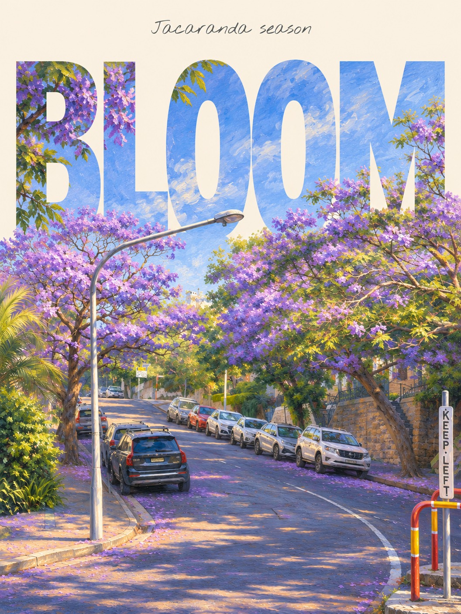
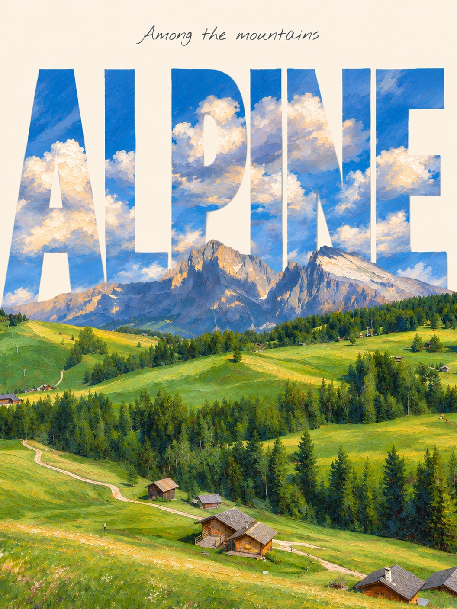
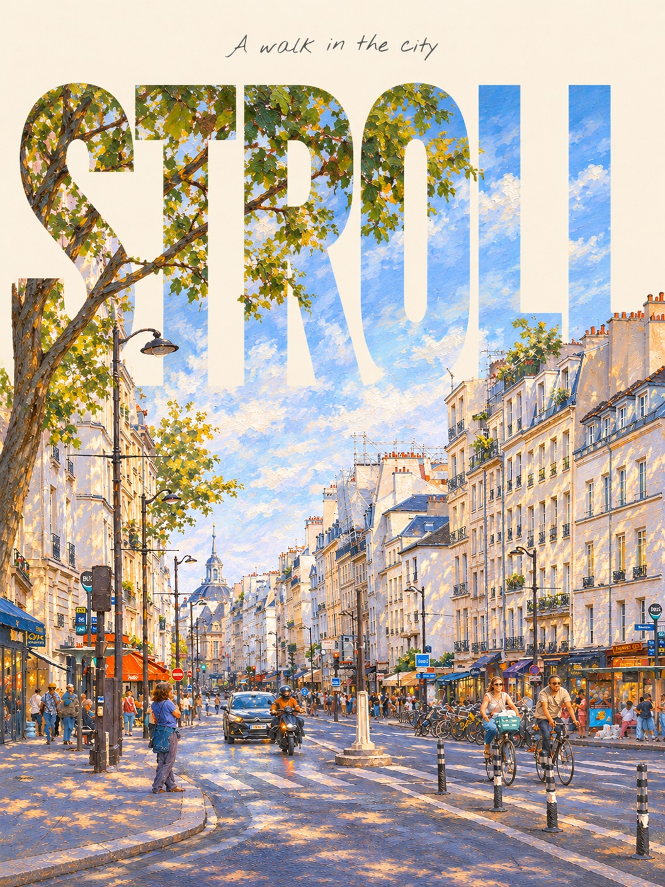
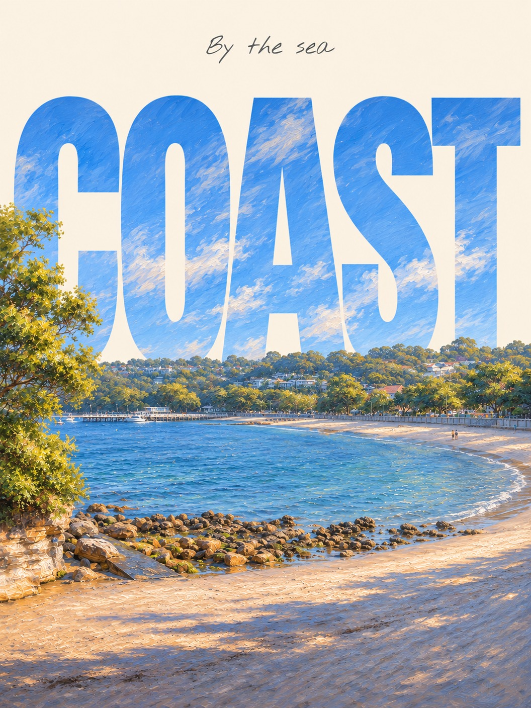
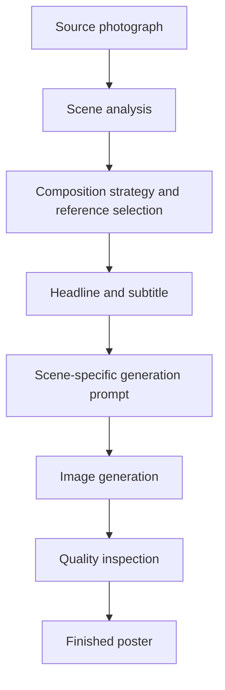

<div align="center">

# Photo to Oil Painting Poster

**Transform everyday photographs into fine-art typographic posters.**

Impressionist oil painting · Image-filled typography · Scene-aware composition

[Gallery](#gallery) · [Quick start](#quick-start) · [How it works](#how-it-works) · [中文说明](#中文说明)

</div>

## Gallery

<p align="center">
  
  
</p>
<p align="center">
  
  
</p>

A reusable AI skill for turning photographs into a cohesive collection of painterly art posters. Rather than applying a simple oil-paint filter or placing text over an image, it integrates the scene into the typography itself.

## Design language

- **Painterly realism:** expressive impasto brushwork, luminous highlights and cool chromatic shadows.
- **Image-filled typography:** oversized condensed uppercase letters revealing one continuous painted scene.
- **Natural depth:** trees, architecture and mountains break through the letterforms.
- **Editorial composition:** warm ivory negative space, delicate handwritten subtitles and a full-bleed landscape.
- **Source fidelity:** preserve recognizable subjects, landmarks and spatial relationships.

## Quick start

1. [Download the repository](https://github.com/wren-zhou/photo-to-oil-painting-poster/archive/refs/heads/main.zip) or clone it.
2. Load it into a compatible AI environment according to the host's skill-import instructions. The entry point is [SKILL.md](SKILL.md). Alternatively, provide the skill files and references to an image-capable assistant.
3. Upload a photograph and request a poster.

### Automatic mode

```text
Use photo-to-oil-painting-poster to transform this photo into a poster.
Choose the headline and subtitle automatically.
```

### Custom typography

```text
Use photo-to-oil-painting-poster.
Headline: ESCAPE
Subtitle: Away from it all
```

### Batch mode

```text
Transform each uploaded photograph into a separate poster.
Maintain a consistent visual style across the collection.
```

The host must provide image-generation capability. This repository contains instructions, templates and visual references, not a standalone renderer or model.

## How it works



The skill separates fixed visual rules from scene-specific decisions. It selects botanical framing, mountain silhouettes, landmark breakthrough, urban perspective, horizon integration or an adaptive composition according to the source photograph.

## Default settings

| Parameter | Default |
| --- | --- |
| Aspect ratio | Vertical 3:4 |
| Painting style | Impressionist oil painting, expressive impasto |
| Headline | Uppercase, preferably 4–7 letters |
| Subtitle | Short handwritten English phrase |
| Headline width | Approximately 90–96% of canvas |
| Negative space | Warm ivory |
| Foreground occlusion | Scene-adaptive |
| Source fidelity | High |

These are descriptive design targets, not exact model controls. Explicit user preferences override the defaults.

## Repository structure

```text
photo-to-oil-painting-poster/
├── SKILL.md
├── README.md
├── references/
│   ├── style-guide.md
│   ├── composition-rules.md
│   ├── typography-rules.md
│   └── quality-checklist.md
├── templates/
│   └── master-prompt.md
└── examples/
    ├── index.md
    ├── 01-bloom/
    ├── 02-alpine/
    ├── 04-stroll/
    └── 05-coast/
```

| Resource | Purpose |
| --- | --- |
| [SKILL.md](SKILL.md) | Core workflow and execution rules |
| [Style guide](references/style-guide.md) | Painting, lighting and color |
| [Composition rules](references/composition-rules.md) | Scene-adaptive layouts |
| [Typography rules](references/typography-rules.md) | Image masks, hierarchy and overlap |
| [Quality checklist](references/quality-checklist.md) | Inspection and targeted repairs |
| [Prompt template](templates/master-prompt.md) | Dynamic generation instructions |
| [Reference index](examples/index.md) | Paired visual reference notes |

## 中文说明

这是一套可复用的照片转油画海报 Skill。通过场景分析、艺术重绘、巨型图像填充字体、手写副标题和前景遮挡，将不同照片转换为统一视觉风格的艺术海报。

默认采用 3:4 竖版构图，自动匹配视觉参考、生成英文标题并保留原图主体。支持自定义文案、批量生成和仅输出提示词。

在支持 Skill 和图像生成的 AI 环境中加载本仓库，上传照片后输入：

```text
使用 photo-to-oil-painting-poster skill，将这张照片转换为油画艺术海报。
```

## Status

Initial v1.0.0 skill package. One new-photo generation was tested during development. Independent-session compatibility, platform-specific installation and batch consistency have not yet been validated.

## Rights

No open-source license has been selected. Reference photographs and artwork are not automatically licensed for redistribution or commercial reuse.
